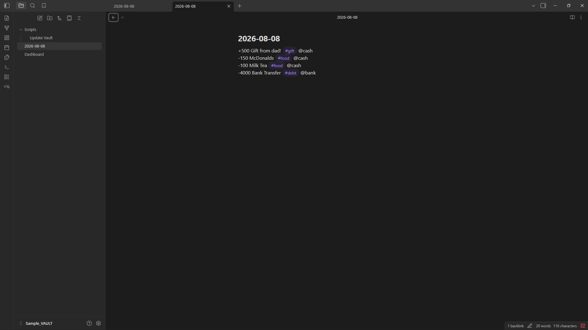
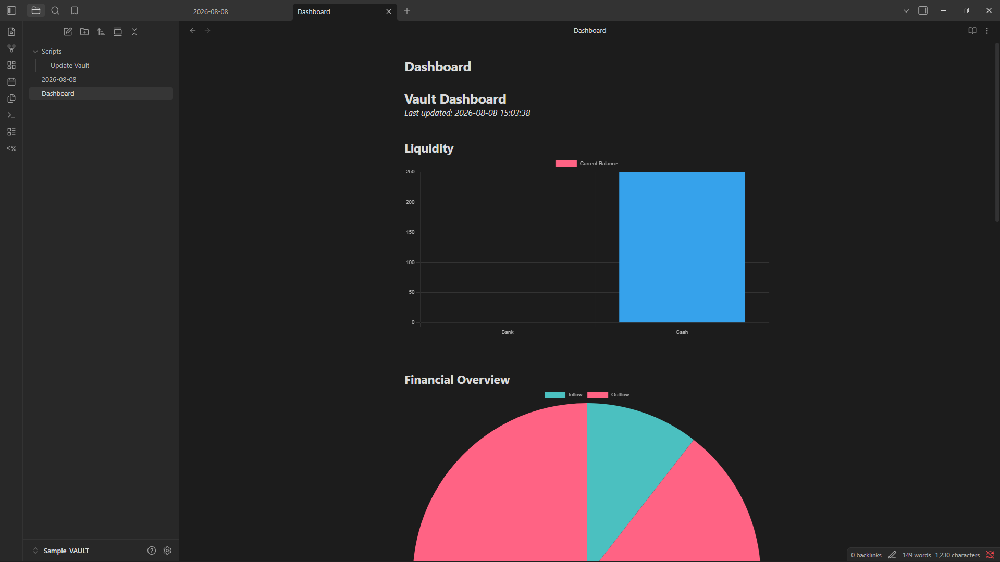
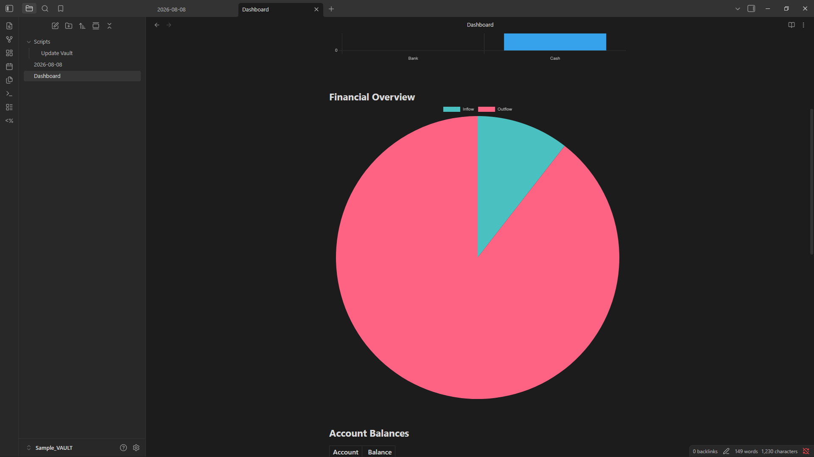
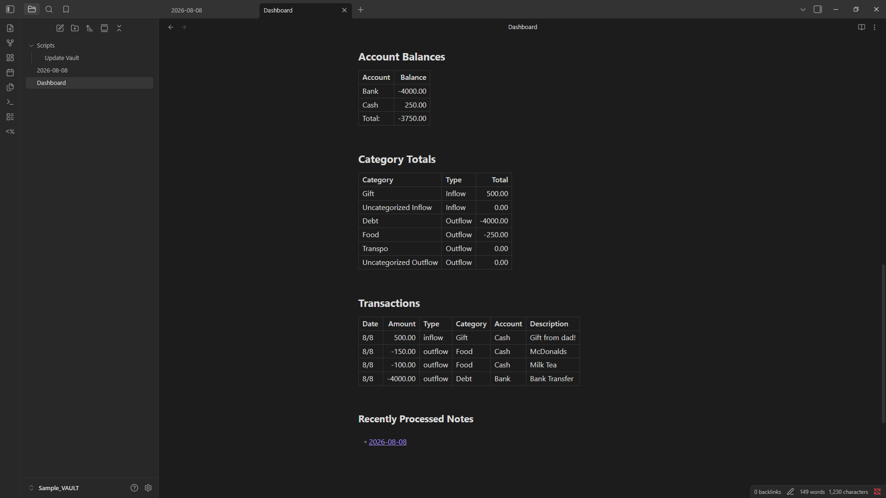

# Vault: An Obsidian-Based Finance Tracker Script

> An automated, local-first personal finance tracker that lives entirely inside your Obsidian Daily Notes

## Introduction

Vault is a third-party executable created to supplement Obsidian as a frictionless personal financial tracker. The program uses the Daily Notes Core Plugin by Obsidian, reads through the folders (required file architecture for notes detailed in Instruction section.) labeled by the date ([YYYY-MM format](#recommended-daily-notes-folder-structure)), and scans through the directory for .md files to read through for lines that fit the regex checker.

## Usage

Vault is designed to get out of your way. To log a transaction, just open your Daily Note (or any markdown file named with the current YYYY-MM-DD format) and type your expense on a single line.

The Syntax
Every transaction must follow this basic structure:
> [Optional Date] [+/-] [Amount] [Description] @[Account] #[Category]

- [+/-]: Use - for expenses and + for income.

- [Amount]: The monetary value (decimals are supported).

- [Description]: What the transaction was for.

- @[Account]: (Required) The account affected (e.g., @wallet, @bank, @gcash).

- #[Category]: (Optional but recommended) Used for grouping in your charts (e.g., #food, #transport).

### Examples

You can place these notes **anywhere** in your notes, Vault will find them.

With the click of a shortcut, Vault will update your local database, and display your information in a dashboard.

Editing and deleting entries are as simple as removing them from your notes, and updating the Vault again.

In addition, `Dashboard.md` creates referential links to the processed notes, allowing them to be shown in Obsidian's graph view.

## How to Install Vault

- Install the latest release
- Unzip the file (Should contain `Vault.exe` and `script.js`)
- On Obsidian, install [Templater by SilentVoid13](https://github.com/silentvoid13/Templater) and [Obsidian Charts by phibr0](https://github.com/phibr0/obsidian-charts) (See [Prerequisites and Credits](#prerequisites--credits))
- **Enable the Plugins:** Go to Obsidian `Settings` > `Community plugins` and enable both Templater and Obsidian Charts.
- **Configure Templater:** Open the Templater settings and designate a **Script files folder** (e.g., `Scripts/`). If you don't have one, create a folder in your vault and select it here. (Also ensure you have a standard Template folder defined).
- **Place the Files:**
  - Move `script.js` into your designated Templater **Script files folder**.
  - Move `Vault.exe` into a new folder named `.vault` at the very root of your Obsidian workspace.
- **Create the Trigger:** Create a new note in your designated Template folder (e.g., name it `Update Vault`) and paste this exact line inside it:
  `<% tp.user.vault_add(tp) %>`
- **Assign a Hotkey:** Go back to the Templater settings, scroll down to "Template Hotkeys", add the `Update Vault` template you just created, and assign it a convenient hotkey (e.g., `Ctrl + Shift + V` or `Cmd + Shift + V`).

## Advanced Configuration (Optional)

By default, the script expects `Vault.exe` to be inside a `.vault/` folder and `Dashboard.md` to be at your vault root.

If you prefer to organize your files differently (e.g., moving the dashboard to a `Personal/Finances/` folder), simply open `script.js` in any text editor. At the very top of the file, you will find a **USER CONFIGURATION** block where you can easily edit the folder paths to match your custom setup.

### Recommended Daily Notes Folder Structure

While Vault reads all files for transaction notes, it's highly recommended to stick to an organized file organization system! Below is a recommended hierarchy (though of course, this is just a suggestion!):

Finances/
├── 2025-11/
│   ├── 2025-11-01.md
│   ├── 2025-11-15.md
│   └── 2025-11-28.md
├── 2025-12/
│   ├── 2025-12-05.md
│   ├── 2025-12-15.md
│   └── 2025-12-31.md
└── 2026-01/
    ├── 2026-01-01.md
    ├── 2026-01-15.md
    └── 2026-01-20.md

This can be easily integrated into the Daily Notes Core Plugin by doing the following:

- Create the parent folder `FolderName` (This can be any name you want!)
- In Obsidian, go to `settings`
- Scroll down and select `Core Plugins > Daily Notes`
- Change the `Custom Format` to: `YYYY-MM/YYYY-MM-DD`
- Change the `New File Location` to `FolderName`

## Prerequisites & Credits

Vault relies on two fantastic community plugins to function within Obsidian. Please install and enable these before setting up the tracker:

- [Templater by SilentVoid13](https://github.com/silentvoid13/Templater): Used to execute the lightweight JavaScript trigger (vault_add.js) that safely tells the backend to scan for new transactions without interrupting your typing workflow.

- [Obsidian Charts by phibr0](https://github.com/phibr0/obsidian-charts): Required to render the liquidity bar charts and financial overview pie charts inside your Dashboard.md file.

> Note: The core architecture and logic of Vault were designed by me, with AI tools utilized to assist in writing boilerplate Python and standardizing the documentation.
